# Nenya



Nenya is a library for nostr clients. It implements NENYA-1, a draft microstandard for a
non-custodial marketplace for digital media. A request states what a buyer wants; an offer
states what a provider will make. Bids propose terms on either. The parties to an order settle
directly in bitcoin over Lightning.

The library holds no funds and runs no server. NENYA-1 has no protocol-level fee. A client may
add an optional handling fee, stated as a signed term of the order.

`nenya-core` is a reference implementation in Kotlin Multiplatform, built for the JVM and for
JavaScript. Other implementations can be written against the specification alone.

## Status

- The specification is a draft: NENYA-1 version `1`, revision `1.13`.
- The library is a proof of concept. It is not published to any package registry and is not
  intended for production use.
- The request kind `30404` is not registered in the nostr kind registry (`OPEN-9`).
- Decisions `OPEN-4` to `OPEN-9` are open. §16.2 of the specification indexes them.
- A [fork of the Coracle client](https://github.com/Erya-Labs/coracle/tree/marketplace) trades
  end to end against the JavaScript build. Its
  [trade guide](https://github.com/Erya-Labs/coracle/blob/marketplace/MARKETPLACE.md) lists the
  steps.

## Documentation

- [`spec/NENYA-1-overview.md`](spec/NENYA-1-overview.md): short overview (non-normative).
- [`spec/NENYA-1.md`](spec/NENYA-1.md): the specification (normative). Conformance is §17.
- [`spec/NENYA-1-companion.md`](spec/NENYA-1-companion.md): rationale, revision history, the
  candidates considered for each decision, and a worked order (non-normative).
- [`docs/INTEGRATING.md`](docs/INTEGRATING.md): integration guide for the JavaScript build.
- [`docs/`](docs/): the figures used in these documents.

## Scope

NENYA-1 specifies:

- requests: addressable `kind:30404` events that reuse the NIP-99 tag vocabulary;
- offers: NIP-99 `kind:30402` listings with added Nenya tags and no other changes;
- bids: NIP-22 `kind:1111` comments addressed to a listing's coordinate;
- a private order channel over NIP-17 gift wrap;
- a signed fee term;
- payment evidence: a Lightning preimage whose SHA-256 equals the invoice's payment hash,
  verified locally;
- a hash commitment on the deliverable, made before payment.

Out of scope (§14 of the specification): custody, escrow, arbitration, index servers, operated
relays or blob servers, identity verification, content moderation, and any fee or protocol role
for the specification's author. NIP-04 is not used, and nothing depends on NIP-15 or NIP-90.

## Architecture


The embedding client supplies the signer, the one-time signer for gift wraps, the relay
transport, the wallet, and the clock and randomness. The library treats each as untrusted and
advances an order only on evidence it verifies itself. It protects a user against
counterparties and relays, not against the embedding client (§3 and §13 of the specification).

## Modules

| Module | Contents |
|---|---|
| `:nenya-core` | Kotlin Multiplatform: one `commonMain` implementation compiled for the JVM and for JavaScript. The Coracle fork runs the JS build. The wire format, the money type, fee arithmetic, the order state machine, event id computation, tag codecs, BOLT-11 parsing and preimage verification. No Android, no network, no I/O. |

`nenya-core` depends only on the Kotlin standard library; tests also use kotlin-test and JUnit.
The package root is `dev.eryalabs.nenya`, with `explicitApi()` enabled.

```
nenya-core/src/commonMain/   implementation shared by JVM and JS
nenya-core/src/jvmMain/      JVM-only implementation
nenya-core/src/jsMain/       JS-only implementation
nenya-core/src/commonTest/   tests run on every target; resources/ holds vectors and fixtures
nenya-core/src/jvmTest/      JVM-only tests
nenya-core/src/jsTest/       JS-only tests
spec/                        the specification and its companion
docs/                        integration guide and figures
```

## Build and test

Requires a JDK 17 toolchain. The JVM tests and the JS compile need nothing else: no Android
SDK, emulator, Node or network access.

```sh
./gradlew :nenya-core:jvmTest :nenya-core:compileTestKotlinJs  # JVM tests + proof common code compiles for JS
./gradlew :nenya-core:jsNodeTest  # JS tests under Node (node on PATH; downloads Yarn and npm packages)
./gradlew :nenya-core:build       # everything, JS included (same downloads)
```

Tests use externally authored vectors where they exist: the BIP-340 CSV, the NIP-44 vector
file, the NIP-17 gift-wrap examples and the BOLT-11 examples. Checks whose failure could cost a
user money also have negative tests that assert rejection.

## Contributing

Review of the specification is the most useful contribution at this stage. Open an issue
rather than a large pull request against the specification. Open decisions are indexed in
§16.2 of the specification; the candidates for each are in §16 of the companion.

## License

MIT. See [LICENSE](LICENSE).

Built by [Erya Labs](https://eryalabs.dev).
