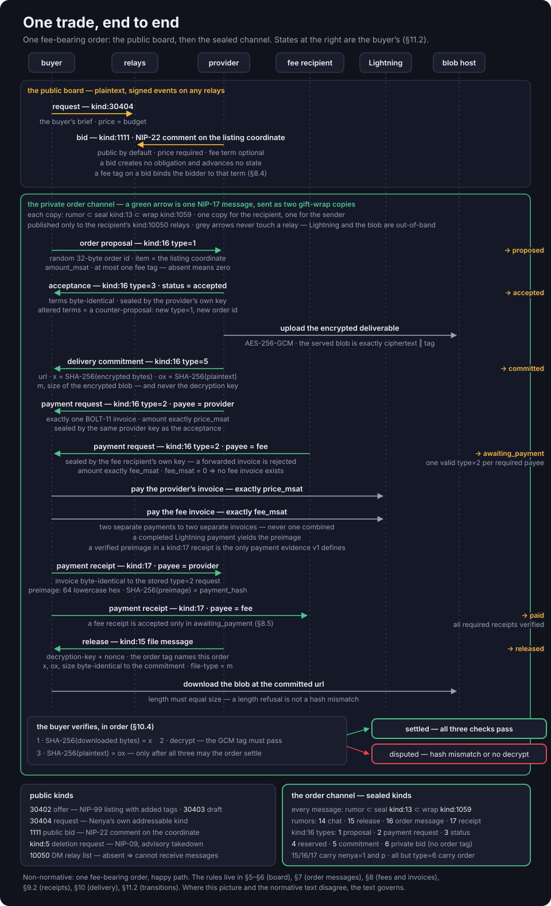
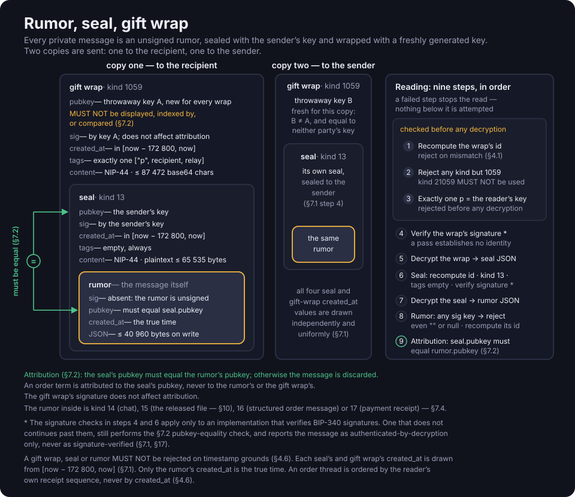
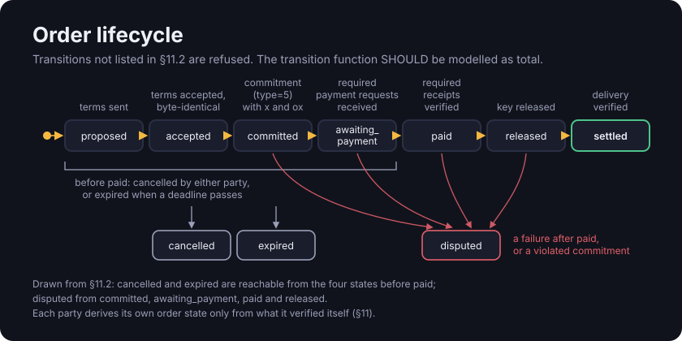
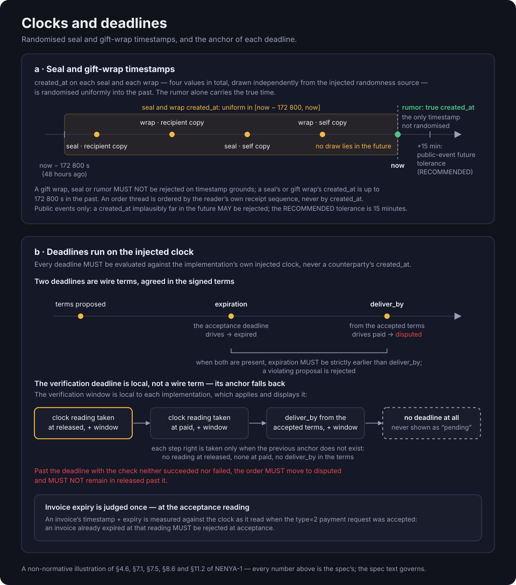
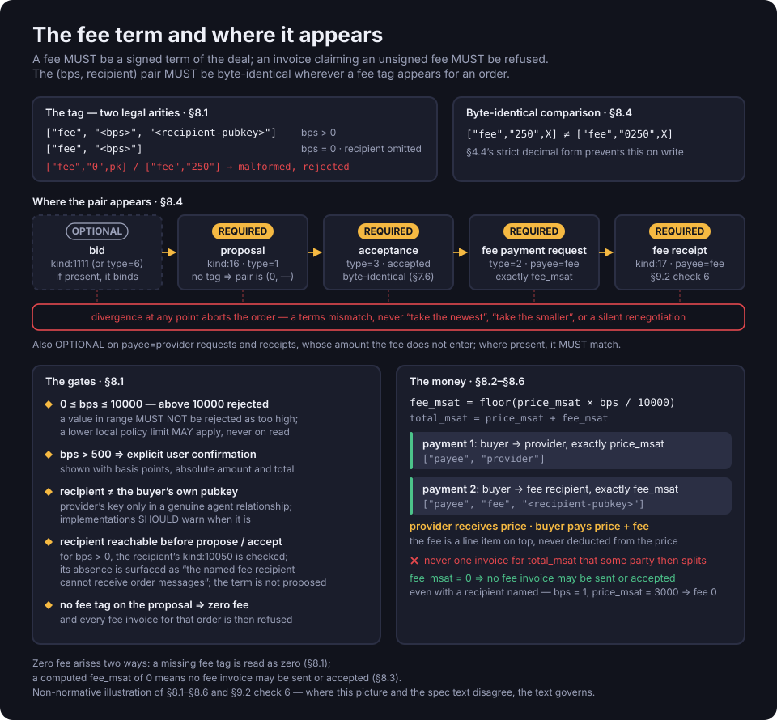
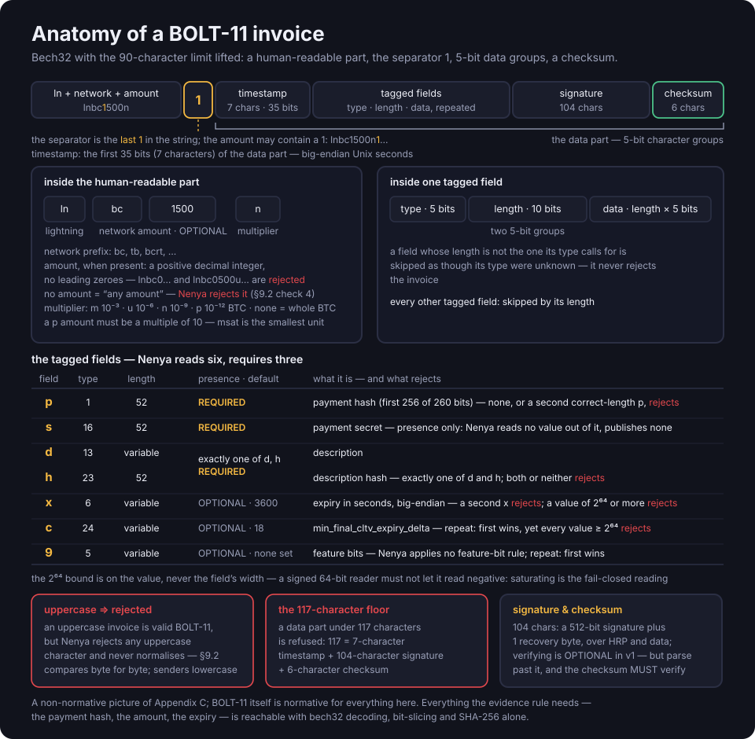
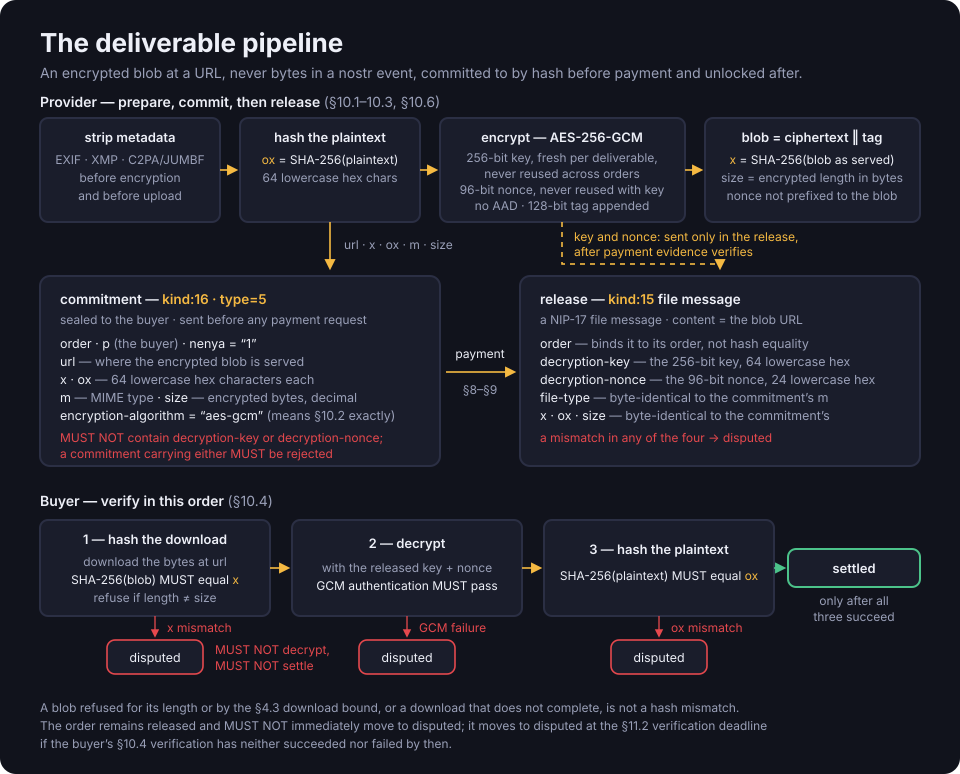

# NENYA-1 overview

Non-normative. The contract is [spec/NENYA-1.md](NENYA-1.md).

## Purpose and scope

Nenya is a wire format for a non-custodial marketplace in digital media on nostr. A buyer posts a
request or a provider posts an offer, and the two settle directly in bitcoin. An optional fee
recipient named in the signed terms receives a handling fee. Nenya is a library, not an
application or a service; `nenya-core` is one reference implementation. The embedding client
supplies the signer, a one-time signer, the relay transport, the wallet, and the clock and
randomness source, each untrusted with respect to order state.

Details: §1, §2, §3.

## Listings and bids

Offers (`kind:30402`) are NIP-99 listings from providers. Requests (`kind:30404`) state what a
buyer wants and a budget. Both are addressable: they are edited by republishing with a newer
`created_at`, and a reference to a listing uses its coordinate, `<kind>:<pubkey>:<d>`, never its
event id. Every public Nenya event carries `["nenya", "1"]` and `["t", "nenya"]`. Terms are
carried in tags; a price, deadline, fee or URL in `content` has no effect. Discovery uses ordinary
relay filters. Relay results are unordered, incomplete and possibly stale, and the absence of an
event is not evidence of anything. An event past its `expiration` is inactive, whichever relay
serves it.

Bids (`kind:1111`) are NIP-22 comments proposing terms on a request, or on an offer as a
counter-offer. A bid is public by default, including its price, terms and author. A private bid
(`kind:16` `type=6`) carries the same terms over the private channel. A bid creates no obligation
and advances no order state, but a fee term on a bid binds the bidder: a later divergence aborts
the order.

Details: §4.2, §4.5, §5, §6.

## Private channel

Every message after the bid is a NIP-17 private message in three layers. The rumor is the unsigned
message, with the true time in `created_at`. The seal (`kind:13`) is the rumor encrypted with
NIP-44 and signed by the sender's key. The gift wrap (`kind:1059`) is the seal encrypted again and
signed by a one-time key, with exactly one `p` tag naming the recipient.

Each message is wrapped twice, once for the recipient and once for the sender, with a different
one-time key on each copy. The four seal and wrap timestamps are drawn at random from the previous
48 hours. A message is discarded unless the seal's key equals the rumor's key, and its terms are
attributed to the seal's key, never to the wrap's. Messages are published only to the relays the
recipient lists in its `kind:10050`. A party without that list cannot receive messages, and a fee
term naming such a fee recipient is not proposed.

| Message | Sender | Purpose |
|---|---|---|
| `kind:16` `type=1` | buyer | order proposal, under a random 32-byte order id |
| `kind:16` `type=3` | either | status update, such as acceptance or cancellation |
| `kind:16` `type=5` | provider | delivery commitment |
| `kind:16` `type=2` | provider, fee recipient | payment request with exactly one BOLT-11 invoice |
| `kind:17` | buyer | payment receipt |
| `kind:15` | provider | release of the deliverable |
| `kind:14`, `kind:16` `type=6` | either, bidder | chat and private bid; neither advances state |

Details: §7, §8.1.

## Order lifecycle

1. `proposed`: the buyer sends `kind:16` `type=1` with the listing coordinate, price in
   millisatoshis, fee term and, optionally, `deliver_by` and an acceptance deadline (`expiration`).
2. `accepted`: the provider sends `type=3` `status=accepted` with byte-identical terms, sealed by
   its own key. Altered terms are a counter-proposal, answered by a new `type=1` and order id.
3. `committed`: the provider commits to the encrypted file's URL and hashes.
4. `awaiting_payment`: every required payment request has arrived and matches the terms.
5. `paid`: every required payment has a verified receipt.
6. `released`: the provider sends the decryption key.
7. `settled`: the buyer has verified both hashes.

`cancelled` (by either party, before `paid`), `expired` (a deadline passed) and `disputed` (a
failure after `paid`, or a broken commitment) are also terminal. v1 has no dispute resolution and
no escrow: the buyer pays before receiving the key, so a paid provider can withhold it. Each party
derives its own order state from evidence it verified itself and does not assume the counterparty
is in the same state. A status update claiming `paid` or `settled` changes no state; only
`cancelled` is accepted on a counterparty's assertion alone, and only before `paid`. Every
unlisted transition is refused.

Deadlines are evaluated against the implementation's own clock, never a counterparty's
`created_at`, and events in an order thread are ordered by receipt sequence. A proposed order
whose `expiration` passes is `expired`. A `paid` order with no release when `deliver_by` passes is
`disputed`; without `deliver_by`, the implementation applies and displays its own release timeout.
A `released` order the buyer has neither verified nor failed to verify is `disputed` once a
verification window, set and displayed by the implementation, has passed.

Details: §4.6, §7.5, §7.6, §11.

## Amounts and fees

Listings and bids state prices in whole satoshis, as `["price", "50000", "SAT"]`. Order messages
use millisatoshis (1 SAT = 1000 msat). Amounts are integers, never floating point, and a read that
would lose precision fails instead of rounding. The price is what the provider receives. The fee,
`floor(price_msat × bps / 10000)`, is added on top: at 50 000 SAT and 250 bps (2.5%), the buyer
pays 51 250 SAT.

A fee exists only as a signed term: `["fee", "<bps>", "<recipient>"]`, or `["fee", "0"]` for no
fee. A proposal without a `fee` tag means zero fee. The protocol range is 0 to 10000 bps. A client
can apply a lower local limit, reported as that limit and not as a protocol error. Above 500 bps,
the user confirms the fee explicitly. The term is byte-identical on the proposal, the acceptance,
the fee payment request and the fee receipt; any divergence aborts the order.

The buyer pays two invoices, never one invoice that a party splits: the provider's, for exactly
the price, and the fee recipient's, for exactly the fee, sealed by the fee recipient's own key and
accepted only in the transition into `awaiting_payment`. A payee is required only if the terms
name it and its expected amount is non-zero, so a fee that computes to zero has no invoice.

Details: §4.4, §8.

## Payment evidence

Evidence is a value an implementation verifies itself, by computation. A wallet's success flag, a
status message, a zap receipt or a relay's acceptance is not evidence and changes no order state.
The only evidence v1 defines is a Lightning preimage: the 32-byte value whose SHA-256 equals the
payment hash of a BOLT-11 invoice. The receipt (`kind:17`) carries
`["payment", "lightning", "<bolt11>", "<preimage>"]`. The payment counts when:

1. the invoice is byte-identical to the stored payment request for the same order and payee;
2. the preimage is lowercase hex of exactly 32 bytes, and its SHA-256 equals the payment hash;
3. the invoice amount equals the payee's expected amount, and the invoice had not expired when its
   payment request was accepted;
4. for a fee, the fee term matches, the fee invoice was sealed by the fee recipient's key, and the
   order was already in `awaiting_payment`.

The payment hash, amount and expiry are read with bech32 decoding, bit-slicing and SHA-256 alone.
Verifying the invoice signature and destination node is optional in v1; an implementation that
skips it does not report the destination as verified. Static Lightning addresses are not used for
settlement. On-chain and ecash payments can be parsed but count as unverified in v1.

Details: §9, Appendix C.

## Delivery

The deliverable is an encrypted file at a URL, never bytes inside a nostr event. Its hashes prove
delivery of the committed bytes, not the file's quality.

1. Encrypt. The provider strips identifying metadata, encrypts the file with AES-256-GCM under a
   key generated for that deliverable, and uploads it.
2. Commit. Before any payment request, a `kind:16` `type=5` states the URL, size, MIME type, `x`
   (SHA-256 of the encrypted file as served) and `ox` (SHA-256 of the plaintext), never the key.
3. Release. After payment verifies, a `kind:15` carries the key and nonce, with `x`, `ox`, size and
   MIME type byte-identical to the commitment. A mismatch makes the order `disputed`.
4. Verify. The buyer checks the download against `x`, decrypts it, and checks the plaintext against
   `ox`. Only then is the order `settled`; a hash mismatch or failed decryption makes it `disputed`.
   A failed download or a blob of the wrong size is not a hash mismatch: the order remains
   `released`, subject to the verification deadline.

Details: §10.

## Exclusions

- No custody, no escrow in v1, and no arbitration.
- No index server, relay, blob server, mint or push server operated or named by the protocol.
- No fee to the specification's author, no default fee recipient, and no identity verification.
- No trade identifiers in invoices or public events, no secrets in logs, and no location tags.
- No protocol-level moderation, no NIP-04, no zap receipts as evidence, and no floating-point money.

Details: §12, §14.

## Further reading

Security considerations are in §13, conformance in §17 and test vectors in §18. Rationale,
revision history and a worked order are in [NENYA-1-companion.md](NENYA-1-companion.md).
